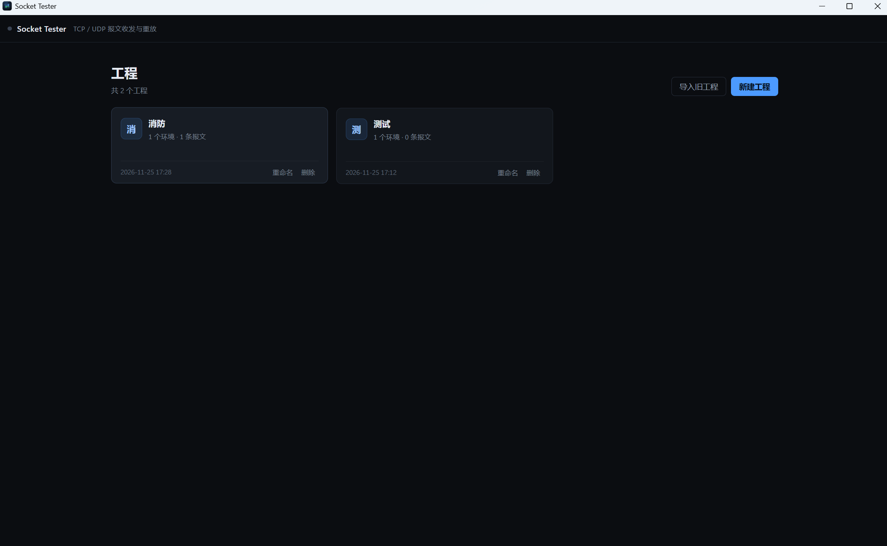
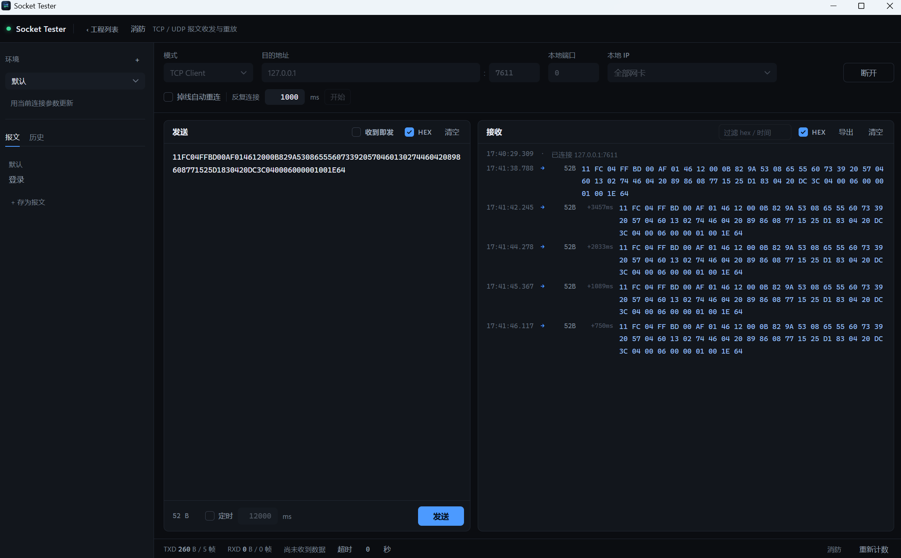
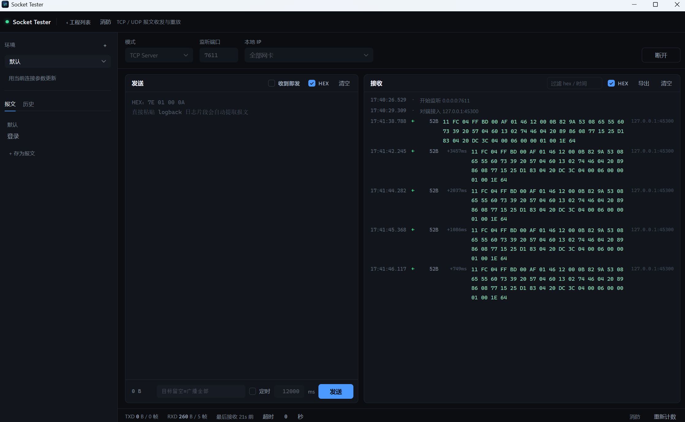
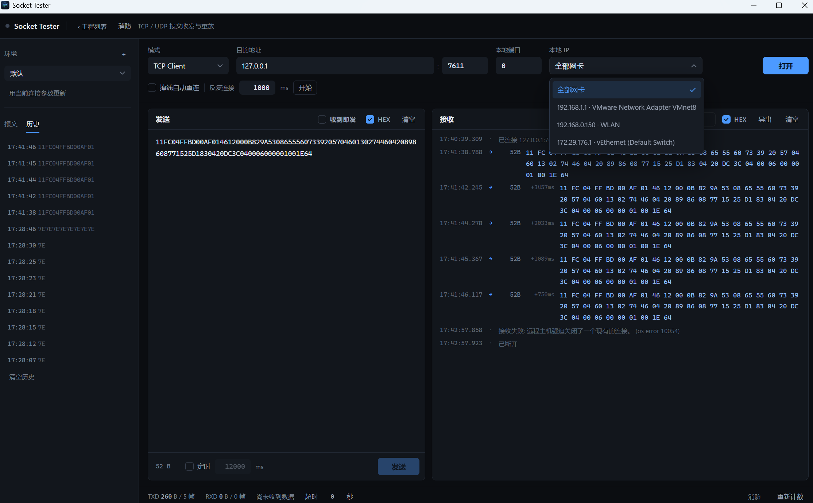

# Socket Tester

> Windows 桌面端的 TCP/UDP 报文手工收发与重放工具。用来按协议文档发送示例报文验证设备，或把线上日志里的报文拿到开发环境原样重发。

## 📋 目录

- [项目简介](#项目简介)
- [技术栈](#技术栈)
- [项目结构](#项目结构)
- [环境要求](#环境要求)
- [快速开始](#快速开始)
- [配置说明](#配置说明)
- [部署指南](#部署指南)
- [常见问题](#常见问题)

## 项目简介

调试 TCP/UDP 接口时，换个环境要重新敲 IP 和端口，报文要重新粘一遍；线上日志里的十六进制报文想复现，还得临时写个客户端。这些琐事比协议本身更耗时间。

这个工具把工程、环境和报文收发放在同一个窗口。环境是一套连接参数的快照，报文按字节原样发送。

### 核心功能

- [x] 工程管理：新建、重命名、删除、导入旧 JSON 工程，卡片显示环境数、报文数与最后修改时间
- [x] 环境：每个工程保存多套连接参数，切换后重新打开连接即可生效
- [x] 三种模式：TCP Client、TCP Server、UDP（可加入 IPv4 组播组）
- [x] 本地 IP/端口绑定，支持选择具体网卡
- [x] HEX 与 ASCII 收发，ASCII 支持 `\r`、`\n`、`\t`、`\\` 转义
- [x] 报文收藏与分组、最近 50 条发送历史
- [x] 定时发送、收到即发、掉线自动重连、反复连接/断开，用于验证设备重连稳定性
- [x] 接收日志过滤、HEX/ASCII 切换、TXT/CSV 导出、帧间隔显示、接收超时告警
- [x] 直接粘贴 logback 日志片段，自动提取其中的发送帧和完整报文
- [x] 工程内容自动保存，不需要手动选保存路径；连接参数改动后点侧栏「用当前连接参数更新」写入当前环境

### 界面预览

| 工程管理 | TCP Client |
| :---: | :---: |
|  |  |
| **TCP Server** | **本地 IP 选择** |
|  |  |

### 工具边界

它只负责搬运字节，不解析协议内容：不会按业务协议拆字段、切帧、算 CRC，也不做变量替换或脚本处理。发送框里除 HEX/ASCII 解析和 `\r` `\n` `\t` `\\` 转义外，没有隐藏的替换逻辑。

这样设计是为了保证重放时字节级忠实：日志里收到什么，发出去就是什么。

## 技术栈

| 分类 | 技术 | 版本 |
| ---- | ---- | ---- |
| 桌面容器 | Tauri | 2.12 |
| 前端框架 | Vue | 3.5 |
| 前端语言 | TypeScript | 6.0 |
| 构建工具 | Vite | 8.3 |
| 网络与异步 | Rust（edition 2024）+ tokio | Rust 1.85+ / tokio 1.54 |
| 文件对话框 | tauri-plugin-dialog | 2.8 |
| 界面样式 | 原生 CSS，无组件库 | - |
| 本地存储 | 每个工程一个 JSON 文件 | - |
| Windows 打包 | Tauri NSIS | - |

## 项目结构

```text
socket-tester/
├── src/                       # Vue 前端
│   ├── App.vue                # 工作区：连接参数、发送、接收、状态栏
│   ├── ProjectsPage.vue       # 工程列表与新建/重命名/删除
│   ├── Sidebar.vue            # 环境切换、报文收藏、发送历史
│   ├── SelectBox.vue          # 暗色自定义下拉
│   ├── types.ts               # 工程、环境、报文、历史类型
│   ├── utils/
│   │   ├── hex.ts             # HEX/ASCII 解析与格式化
│   │   └── logback.ts         # 从日志文本提取报文帧
│   └── style.css              # 全局主题、布局与控件样式
├── src-tauri/                 # Tauri + Rust
│   ├── src/lib.rs             # TCP/UDP 会话、收发循环、日志推送、工程文件读写
│   ├── src/main.rs            # 桌面入口
│   ├── icons/                 # 应用图标；icon-source.svg 为设计源文件
│   ├── capabilities/          # Tauri 权限配置
│   └── tauri.conf.json        # 窗口、标识与打包配置
├── assets/                    # README 截图
├── build.bat                  # Windows 一键打包脚本
└── vite.config.ts             # 前端构建配置
```

## 环境要求

- Windows 10 或 Windows 11，x64
- WebView2 Runtime（Windows 11 自带；Windows 10 一般随 Edge 安装，缺失时需安装 Evergreen Runtime）
- Node.js 20.19+ 或 22.12+（Vite 8 的要求）
- Rust stable 1.85+（项目使用 edition 2024）
- Visual Studio 2022 Build Tools，勾选「使用 C++ 的桌面开发」和 Windows SDK，供 Rust 链接使用
- 首次打 NSIS 安装包需要联网下载 NSIS 工具

不需要数据库、Redis 或其他中间件。

## 快速开始

### 运行开发版

```powershell
npm install
npm run tauri dev
```

`tauri dev` 会同时启动 Vite 和桌面窗口。首次编译 Rust 依赖需要几分钟，之后改前端会热更新。

只运行 `npm run dev` 也能打开页面，但 `invoke` 调用没有 Rust 后端，连接和工程读写都会失败。

### 打包 Windows 安装包

```powershell
.\build.bat
```

脚本等价于：

```powershell
npm run tauri build -- --bundles nsis
```

产物在：

```text
src-tauri\target\release\socket-tester.exe
src-tauri\target\release\bundle\nsis\Socket Tester_0.1.0_x64-setup.exe
```

### 基本使用

启动后先进入工程列表。新建工程后进入工作区，连接参数、报文和发送历史都保存在这个工程里。

| 模式 | 适用场景 | 目标地址留空时 |
| ---- | ---- | ---- |
| TCP Client | 主动连接设备或服务端 | 不适用，必须填写目的地址和端口 |
| TCP Server | 本机监听，等待设备接入 | 广播给全部已连接客户端 |
| UDP | 无连接收发，可加入组播组 | 发给最近一次收到数据的对端 |

改报文、分组、历史或环境后，工程会在 800ms 内自动保存。手动修改 IP、端口等连接参数时，点侧栏的「用当前连接参数更新」才会写进当前环境。

发送区切到 HEX 后按字节填写，例如 `7E 01 00 0A`；切到 ASCII 后可以直接输入文本，用 `\r\n` 表示回车换行。`Ctrl+Enter` 发送。

接收区可以按 HEX 片段或时间过滤，勾选 HEX 切换显示方式；帧间隔会在每条记录右侧标出。设置「超时」秒数后，超过该时间没有收到数据会标红。

从日志平台复制一段包含 `帧=` 或 `完整报文(N字节):` 的 logback 日志，粘贴到发送框会自动提取报文，并可用前后按钮逐帧查看。

## 配置说明

| 配置项 | 位置 | 说明 | 默认值 |
| ---- | ---- | ---- | ---- |
| 工程存储目录 | Tauri app data | 每个工程一个 `<id>.json`，工程数据修改 800ms 防抖自动保存 | `%APPDATA%\com.socket.tester\projects` |
| 窗口尺寸与标题 | `src-tauri/tauri.conf.json` | 应用窗口初始大小、标题、最小尺寸 | 1500×900，最小 960×640，标题 `Socket Tester` |
| 应用标识 | `src-tauri/tauri.conf.json` → `identifier` | 决定 app data 目录名 | `com.socket.tester` |
| 新工程默认环境 | `src/App.vue` → `blankProject()` | 新建工程时的初始连接参数 | TCP Client / `127.0.0.1:7611` / 本地端口 0 |
| 日志保留上限 | `src/App.vue` → `MAX_LOGS` | 内存中保留的接收日志条数，超出丢弃最旧记录 | 5000 |
| 发送历史上限 | `src/App.vue` → `pushHistory()` | 每个工程保留的发送记录数 | 50 |

旧版本手工保存的 `.json` 工程可以在工程页点「导入旧工程」迁入，导入后统一存到上面的工程目录。

## 部署指南

双击 `Socket Tester_0.1.0_x64-setup.exe` 按向导安装。安装包当前没有代码签名，Windows SmartScreen 可能提示「Windows 已保护你的电脑」，需要点「更多信息 → 仍要运行」。

工程数据在用户目录，不在安装目录。升级或重装不会自动覆盖已有工程；迁移机器时直接复制 `%APPDATA%\com.socket.tester\projects` 即可。

安装包不带 WebView2 离线包。NSIS 安装流程默认联网下载 WebView2 Bootstrapper（`downloadBootstrapper`）；离线机器需要提前安装 Evergreen Runtime，否则应用启动时无法创建窗口。

## 常见问题

**Q: TCP Server 启动了，但设备连不上？**

A: 先确认监听端口没有被防火墙拦截，在 Windows 防火墙里允许应用访问专用网络。也可以用 `netstat -ano | findstr :7611` 确认端口处于 `LISTENING` 状态。

**Q: UDP 发送提示「尚未收到数据，请填写目的 IP 和端口」？**

A: 目标地址留空时会发给最近一次收到数据的对端。还没收到过任何数据时没有这个对端，需要在发送栏填写 `ip:port`。

**Q: 提示「HEX 字符数为奇数，无法组成完整字节」？**

A: 每个字节必须两位十六进制，例如 `7E 1 0A` 要补成 `7E 01 0A`。手动粘到 HEX 发送框时，如果混入时间戳或中文，也会触发类似提示。

**Q: 粘贴日志没有自动提取报文？**

A: 提取依赖日志里的 `帧=`（发送）或 `完整报文(N字节):`（接收）锚点。格式不匹配时不会强行解析，可以手动从日志里复制十六进制部分。

**Q: 切换环境后连接参数没变？**

A: 环境切换会更新界面上的连接参数，但已经建立的连接不会自动重连。断开后重新点「打开」才会使用新参数。

**Q: 为什么发送内容不能写变量？**

A: 这是有意限制。工具用于重放真实报文，要求字节级忠实，不引入 `{{}}` 之类的替换规则。需要构造动态报文时，在上游脚本或代码里生成好再粘贴进来。
